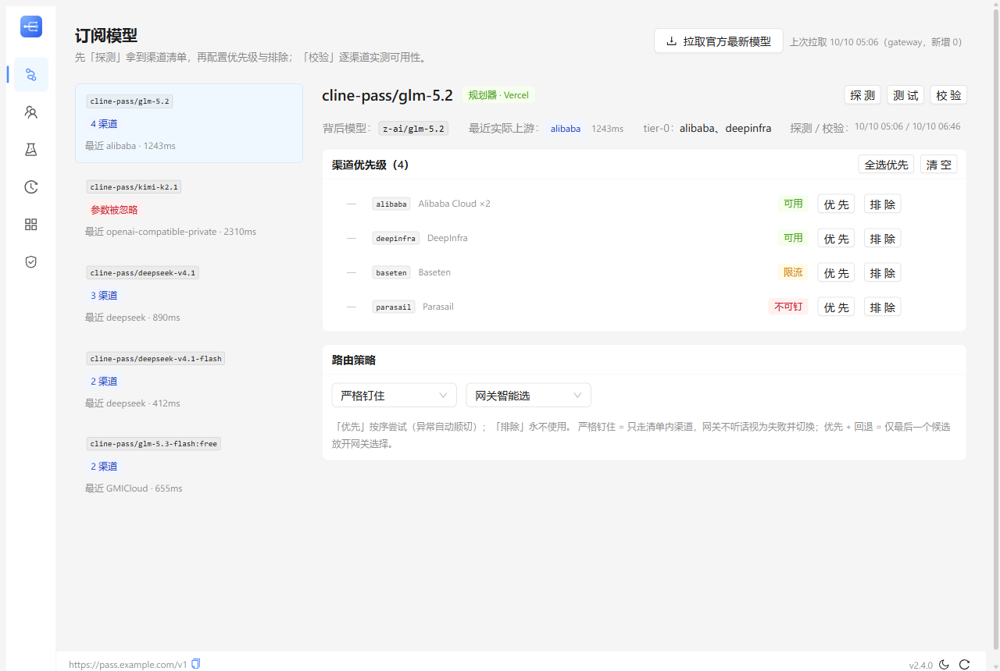

# Cline Pass 上游控制台（cline-pass-switcher）

**本仓库是原项目的独立分叉，由本人自主维护，不向上游提交。**

[](LICENSE)


本地/服务器代理 + 网页控制台，用于 [Cline Pass](https://cline.bot/cline-pass) 订阅：

- 🔍 **上游枚举与校验** —— 列出订阅模型背后每一条上游渠道，一键实测「✔可用 / ⏳限流 / ✘不可钉」
- 🎯 **精确钉住上游** —— 严格钉住 / 优先+回退，支持按最低成本、最快首字、最高吞吐排序
- 🧬 **故障转移 2.0** —— 错误三分类（账号级/渠道级/请求级）决定「换账号、重试还是切渠道」；
  全局预算封顶不让 agent 卡死；失败渠道冷却沉底；**一切以保住 prompt cache 为先**
- 🚫 **上游排除** —— 排除的渠道永不被使用（换算成白名单注入）；清单过期时显式告警而非静默失效
- 👥 **账号池** —— 粘性（默认，保缓存）/ 单账号 / 轮询；账号级错误自动轮转
- 📊 **观测** —— 每条请求记录实际渠道、耗时、逐次尝试序列；渠道失败自动学习
- 🔑 **代理密钥** —— timingSafeEqual 比较、密钥掩码、跨源防护、公网空密钥拒绝启动



> 控制台支持亮/暗色主题（跟随系统 + 手动切换 + 持久化）；截图为亮色。

---

## 30 秒上手

```bash
npm install
npm run build     # 编译 server（tsc）与 web（vite）
npm start         # http://127.0.0.1:3123/
```

打开控制台，在「账号池」添加你的 Cline Pass 账号（`sk_` 开头的 key）并保存。

> Cline Pass key 从哪里来？购买 Cline Pass 订阅后，在 Cline 的账户设置里创建 API Key。
> 订阅模型 ID 均为 `cline-pass/*` 前缀（如 `cline-pass/glm-5.2`）。

客户端接入（任何 OpenAI 兼容工具）：

```
Base URL: http://127.0.0.1:3123/v1
API Key:  （控制台「访问与安全」里设置代理密钥；本地留空 = 不鉴权）
Model:    cline-pass/glm-5.2 等
```

开发模式：`npm run dev`（server `node --watch` + web `vite` 热更新，API 代理到 3123）。

---

## 桌面应用（Windows）

不想开终端的话，可以打包成桌面应用（托盘常驻）：

```bash
npm run desktop:build   # 产物在 desktop/target/{release,nsis}/
```

- **托盘常驻**：启动后仅驻留托盘（不自动弹窗）；打开控制台 / 启动 / 停止 / 重启 /
  打开日志目录 / 退出；左键点图标开窗
- **自绘标题栏**：没有系统标题栏，标题栏由页面绘制（拖拽移动、双击最大化，
  右上角最小化 / 最大化 / 关闭）。关闭按钮与系统一致：**进托盘**，不退出服务
- **关窗自动进托盘**，不退出服务；托盘「退出」才真正结束（先优雅落盘再结束进程树）
- **防残留保证**：服务进程挂在壳的 kill-on-close 作业树上——壳无论怎么死
  （正常退出 / 崩溃 / 被任务管理器强杀），OS 都会终止整棵服务进程树，不会留下
  「界面关了进程还在」的幽灵
- **常驻状态栏**（54px，三个分区）：① 服务——状态点 + 状态词 + 启动/停止/重启 +
  打开日志；② 接入——接入地址（可复制）与访问密钥入口（点进「访问与安全」设置）；
  ③ 应用——版本 / 主题 / 刷新全部数据。服务启动失败时页面顶部会给出原因与重试
- 控制台与壳之间走**本机回环 HTTP 控制通道**（默认 `127.0.0.1:3122`），
  只放行控制台自身来源；任意网页都无法越权启停你的服务
- **便携版**：`desktop/target/portable/cline-pass-switcher-<版本>-portable.zip`——
  解压即用，数据（配置/密钥/日志）就地保存在解压目录的 `data/` 里，
  **删除目录 = 彻底清除**。安全提示：config.json 含上游密钥，便携介质丢失即密钥泄露；
- **双形态规则**（VS Code Portable Mode 同款检测）：exe 旁存在 `data` 目录 = 便携模式，
  不存在 = 安装模式（数据走 `%APPDATA%\com.wintervault.clinepass`）。同一台机器上
  便携版与安装版**不能同时运行**（同端口 + 单实例标识）；
- 数据目录（安装模式）：`%APPDATA%\com.wintervault.clinepass`；日志在其 `logs/` 子目录
- **卸载/升级**：安装包与卸载器会先优雅停服（落盘）再动文件，运行中直接卸载也安全；
  卸载**默认保留数据目录**（配置含密钥），彻底清除请手动删除上述目录
- 前提：系统需安装 Node.js ≥ 20

## Docker 部署

### 方式 A：All-in-one（自带 Caddy 自动 HTTPS，推荐新手）

```bash
mkdir -p data && cp config.example.json data/config.json
# 编辑 data/config.json，或启动时用环境变量注入 key

# 有域名（A 记录指向服务器，自动签发 Let's Encrypt 受信证书）：
CPASS_DOMAIN=pass.example.com docker compose -f deploy/docker-compose.all-in-one.yml up -d --build

# 只有 IP（自签证书，浏览器需手动信任一次）：
docker compose -f deploy/docker-compose.all-in-one.yml up -d --build
```

多阶段构建：最终镜像只含编译产物与 2 个生产依赖（pino/zod）；`/healthz` 供编排探活。

### 方式 B：已有反代（nginx 门户等）

根目录 `docker-compose.yml` 只启动应用并绑定 `127.0.0.1:3123`，TLS 交给现有反代：

```nginx
location / {
    proxy_pass http://127.0.0.1:3123;
    proxy_http_version 1.1;
    proxy_set_header Host $host;
    proxy_set_header X-Forwarded-Proto https;
    proxy_buffering off;            # 流式响应必须
    proxy_read_timeout 600s;
}
```

> 若反代域名与 Origin 不一致，把域名加进控制台「访问与安全」的 CORS 白名单。

### 环境变量

| 变量 | 说明 |
|---|---|
| `CLINE_PASS_KEY` | 上游 Cline Pass API Key（无 config 时自动创建账号） |
| `PROXY_KEY` | 下游代理密钥；**绑定非回环地址时必填，否则拒绝启动** |
| `PUBLIC_BASE_URL` | 门户展示的公网代理地址，如 `https://pass.example.com` |
| `PORT` / `BIND_HOST` / `DATA_DIR` | 端口 / 绑定地址（容器内 0.0.0.0）/ 配置目录 |
| `LOG_LEVEL` | 日志级别（默认 info；`debug` 更啰嗦） |
| `ALLOW_INSECURE_BIND` | `1` 时允许非回环绑定且无密钥（仅限隔离内网） |

---

## 配置参考（config.json，版本 2）

| 字段 | 说明 |
|---|---|
| `version` | 配置格式版本，当前 2；低版本自动迁移，损坏自动备份重建 |
| `accounts` | 账号池：`[{ name, key, enabled }]` |
| `accountMode` | `sticky`（默认，保 prompt cache）/ `single` / `roundrobin` |
| `activeAccount` | single 模式使用的账号下标 |
| `proxyKey` | 下游代理密钥；空 = 不鉴权（仅限回环绑定） |
| `publicBaseUrl` | 公网代理地址（展示用） |
| `corsOrigins` | CORS 白名单（默认空 = 不发跨域头） |
| `exposeCatalog` | `true` 时 `/v1/models` 合并完整目录模型 |
| `knownModels` | 订阅模型清单（可「拉取官方最新」合并，成功调用自动收录） |
| `perModel` | 每模型钉住配置：`{ upstreams, exclude, pinMode, sort }` |
| `failover` | `{ attemptTimeoutMs:60000, budgetMs:90000, retriesPerChannel:1, cooldownMs:300000, retryBackoffMs:500 }` |
| `historyLimit` | 请求历史上限（默认 500） |

数据文件损坏不会丢：`config.json` / `metadata.json` 原子写 + 损坏自动备份为 `*.broken-<时间>`。

---

## 核心机制：Cline Pass 的两条路由管道（实测发现）

Cline Pass 订阅模型在 Cline 网关之后分成两条管道，钉住上游的写法**完全不同**：

| 管道 | 实际后端 | 识别特征 | 钉住方式 |
|---|---|---|---|
| **直连**（direct） | OpenRouter | 响应顶层带 `provider` 与真实 `model` 字段 | 顶层 `provider.only / order` |
| **规划器**（planner） | **Vercel AI Gateway** | 响应带 `provider_metadata.gateway.routing` | **`providerOptions.gateway.only / order / sort`** |

> ⚠️ **2026-09 起的现实（详见 [docs/pinning.md](docs/pinning.md)）**：`providerOptions.gateway.*`
> 是否被执行取决于**账号风控状态且随时间变化**——部分账号生效，被风控的账号参数被整体丢弃、
> 请求一律路由到 `openai-compatible-private`。只有 deepseek-v4.1-flash 等少数模型可钉，
> glm/kimi 钉不了。直连管道（`:free` 模型）的顶层 `provider.only` 一直有效。
> 本代理用「合法形状的不存在渠道」做探针逐模型判定（enforced / ignored / unknown），
> ignored 时停用注入与校验并在 UI 明示；strict 钉住的结果会被审计，网关不听话就切换。

**关键发现（2026-09-17 实测，现已部分失效，保留作背景）**：规划器管道的请求由 Vercel AI Gateway 执行，请求体里的顶层 `provider.only/order` 会被 Cline 丢弃
（这也是官方 API 上"换上游不生效"的原因），但 `providerOptions.gateway` 嵌套形式会**原样透传**：

```json
{
  "model": "cline-pass/glm-5.2",
  "messages": [],
  "providerOptions": { "gateway": { "only": ["alibaba"] } }
}
```

实测响应：`finalProvider: "alibaba"`，规划器理由变为 `Provider set restricted to: alibaba`。
参考：[Vercel AI Gateway — Provider Filtering, Ordering & Sorting](https://vercel.com/docs/ai-gateway/models-and-providers/provider-filtering-and-ordering)

### 上游枚举的手段（按可靠性排序）

1. **执行链解析**（2026-10 起的主要来源）：`planningReasoning` 的
   `System credentials planned for: … / Total execution order: …` 给出**完整候选池（含链首）**；
   `fallbacksAvailable` 的语义是「执行链去掉链首」，链首渠道不在其中，不能单独作清单；
2. **响应元数据回读**：规划器管道带 `canonicalSlug` / `finalProvider`（**必须并入清单**，
   否则链首渠道永远缺席）；直连管道顶层 `provider` 即实际上游；
3. **钉住探针**（仅 enforced 账号可用）：带「合法形状的不存在渠道」
   （如 `zzz-not-a-provider`，**不能用** `__probe__` 这类下划线形状——会被静默丢弃）
   让网关在路由层报错并列出精确清单；
4. **OpenRouter 公开接口** `GET /api/v1/models/{slug}/endpoints`：补充上下文长度/在线率（对直连管道有直接参考意义）。

### 实测记录（2026-09）

| 实验 | 结果 |
|---|---|
| glm-5.2 + 顶层 `provider.only/ignore/order` | 全部被网关丢弃，恒选同一渠道 |
| glm-5.2 + `providerOptions.gateway.only:["alibaba"]` | ✔ `finalProvider: alibaba` |
| glm-5.2 流式 + `only:["baseten"]` | ✔ 流式同样生效 |
| glm-5.2 + `providerOptions.gateway.sort:"cost"` | ✔ 按成本重排执行顺序 |
| glm-5.3-flash（直连）+ 顶层 `provider.only:["gmicloud"]` | ✔ `provider: "GMICloud"` |
| glm-5.3-flash + `providerOptions.gateway` | ✘ 无效（直连管道只认顶层 provider 形式） |
| 2026-09-20 起探针（合法形状不存在渠道） | 部分账号从「报错带清单」变为「200 正常完成」→ 参数被整体丢弃 |
| 2026-09-30 `providerOptions.gateway.sort` | ✘ 响应元数据无 `gateway.routing.sort` 字段（Vercel 文档说生效时会有）→ 整个路由选项块被丢弃 |
| 2026-10-02~04 双账号对照 | 同套餐两账号：一个钉住生效（无效 slug 被拒绝），另一个钉什么都 200、一律 `openai-compatible-private` |

> 管道归属由 Cline 侧决定、可能随时间变化，控制台的「探测」会刷新每个模型的管道类型与渠道清单；
> 可钉性按账号风控而异（换个账号结果可能不同），探测结果只代表探测时刻、所用账号的状态。

---

## 故障转移语义（2.0 重写）

prompt cache 是一等约束：agent 多轮对话每轮带完整上下文，切渠道或切账号都会让上游缓存
全失效（cache-miss 计价可能贵一个数量级）。所以整体取向是**默认稳定，按需快速切换**：

| 错误类别 | 判定 | 动作 |
|---|---|---|
| **账号级** | 401 / 402 / 403、key 失效、额度用完 | **立即换账号**（不重试），同一渠道重来 |
| **渠道级** | 429 / 5xx / 网络失败 / 超时 | 同渠道退避重试 ≤ `retriesPerChannel` → 仍失败则标记冷却并切下一个候选 |
| **请求级** | 其余 4xx | 同渠道重试一次即切换（`invalid_request_error` 兼有「渠道映射失败」与「参数错误」两种含义，从文本无法可靠区分，用「重试是否复现」区分） |

- **预算封顶**：整条链 `failover.budgetMs`（默认 90s）；每次尝试超时 = min(单次上限, 剩余预算)。agent 场景下绝不久挂。
- **冷却**：渠道级失败进入 `cooldownMs`（默认 5 分钟）冷却，期间排到候选末尾（不剔除）。
- **账号粘性**：一次请求固定一个账号；粘性模式跨请求也固定，只有账号级错误才轮转。
- **preferred = 本地说了算**：前面的候选逐个 strict，只给**最后一个候选**放开网关回退。
- **钉住结果审计**：strict 钉住且探针确认参数被读取时，校验响应里的 `finalProvider` 是否等于目标
  （slug 等价比较防显示名误判）；不符视为该渠道确定性失败、立即切换。流式只能在流结束后标记
  「⚠ 钉住未生效」（元数据在最后一帧才出现，无法撤回）。
- **客户端断开**：立即终止整条链，不再花一分钱。
- 流式在 SSE 开始前可切换；SSE 一旦开始即透传不可重试（HTTP 头必须先于 body，
  所以流式响应没有 `X-Cline-Actual-Upstream` 头，该信息记在请求历史里）。

---

## 控制台功能一览

| 页面（左侧导航） | 功能 |
|---|---|
| 订阅模型 | 主从布局：左侧模型列表（渠道数/最近路由一屏扫完），右侧勾选「使用」的渠道按序尝试、排除与路由策略、探测渠道 / 试发一次 / 校验 N 个渠道 |
| 账号池 | 卡片列表：就地测试 / 启停 / 切换策略，弹窗编辑名称与密钥（删除有确认）、密钥掩码显示、粘性/单账号/轮询、用量统计 |
| 访问与安全 | 下游密钥（掩码回显）、公网地址、CORS 白名单、目录暴露开关 |
| 主题 | 亮/暗色跟随系统 + 手动切换 + 持久化（右上角切换按钮） |
| 测试台 | 任选模型+渠道发小请求，看网关是否采纳 + 尝试序列 |
| 请求历史 | 自动记录账号、实际渠道、耗时、尝试序列（默认 500 条，含流式）；成败摘要 + 失败行标红 + 按成败筛选 |
| 完整目录 | Cline 公开目录模型，`:free` 变体可精确钉住 |

代理做了兼容性标准化：解包 Cline 的 `{"data":...}` 包装、错误统一为 `{"error":{"message":...}}`、
附加 `X-Cline-Target-Upstream / X-Cline-Actual-Upstream / X-Cline-Attempts / X-Cline-Account` 响应头。

---

## 从 1.2 升级

配置文件自动迁移（`apiKey` → 账号池、单 `upstream` → 优先级列表、`roundrobin` → `sticky`），
启动日志会列出每一项。行为变化与原因见 [CHANGELOG.md](CHANGELOG.md)；
真实网关的手动验收清单见 [docs/UAT.md](docs/UAT.md)。

## 安全提醒

- `config.json` / `data/` 含明文密钥，已在 `.gitignore` / `.dockerignore` 排除，**不要提交或分享**；
- 对外部署**必须**设置 `proxyKey`（代码强制：非回环绑定 + 空密钥拒绝启动）；
- 故障转移的重试会放大请求量，注意额度消耗（预算封顶可限制最坏情况）。

## License

[MIT](LICENSE)
